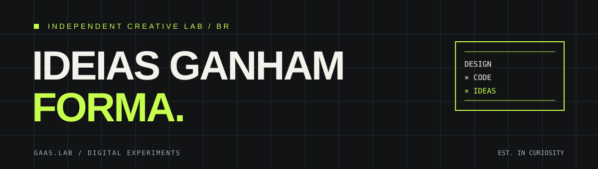

<div align="center">

# gaas.lab

### IDEIAS GANHAM FORMA.

**DESIGN × CODE × IDEAS**

Laboratório independente de design, tecnologia e experimentação digital.



[O Bravio](#-o-bravio) · [Funcionalidades](#-o-que-o-sistema-oferece) · [Começar](#-começar) · [Deploy](DEPLOY.md) · [Tecnologias](#-tecnologias)

</div>

---

## // O Bravio

O **Barbearia Bravio** é um sistema web de gestão que reúne agenda, serviços, equipe e acompanhamento financeiro em uma plataforma.

O gerente tem uma visão geral da operação; cada barbeiro acessa sua própria área. A aplicação pode funcionar com armazenamento local em um navegador ou sincronizar os dados entre dispositivos usando Supabase.

🌐 **[Acessar aplicação](https://barbearia-bravio.vercel.app/)**

## // O que o sistema oferece

### Agenda

- Visualização da agenda da barbearia
- Organização de horários por barbeiro
- Controle dos atendimentos
- Gestão individual da agenda de cada profissional

### Serviços e equipe

- Cadastro e gerenciamento dos serviços oferecidos
- Gerenciamento dos barbeiros e de seus acessos
- Área individual para cada profissional
- Convite de barbeiros por e-mail com criação de senha pelo próprio usuário

### Financeiro

- Acompanhamento dos valores gerados pelos atendimentos
- Organização das informações financeiras da barbearia

### Acesso e modo local

- Autenticação por e-mail com Supabase
- O primeiro cadastro no Supabase inicializa o gerente e a barbearia
- Cadastros seguintes entram por convite do gerente
- Modo local para desenvolvimento em um único navegador, sem configurar Supabase

## // Tecnologias

| Tecnologia | Uso |
| --- | --- |
| React | Interface e componentes |
| Vite | Desenvolvimento e build |
| JavaScript | Lógica da aplicação |
| Supabase Auth | Cadastro, login, convites e sessão |
| Supabase Postgres, RLS e Realtime | Persistência, permissões e atualização entre dispositivos |
| Supabase Edge Functions | Criação e gerenciamento de contas de barbeiros |
| CSS | Layout e estilos |
| Vercel | Hospedagem e publicação |

## // Começar

### Pré-requisitos

- Node.js e npm
- Git

### Instalação

```bash
git clone https://github.com/gaas-lab/barbearia-bravio.git
cd barbearia-bravio
npm install
npm run dev
```

O Vite informa o endereço local no terminal. Sem variáveis do Supabase, a aplicação usa o modo local no navegador.

## // Configurar Supabase e publicar

Para autenticação, persistência e sincronização entre dispositivos, configure o Supabase. O passo a passo inclui migrations, autenticação, convites, Edge Function, SMTP e variáveis da Vercel:

**[Abrir o guia de deploy](DEPLOY.md)**

Use `.env.example` como referência para criar `.env.local`. No frontend, use somente a chave publicável/anon. Nunca inclua uma chave `service_role` em arquivos `.env` versionados ou variáveis `VITE_*`; ela deve permanecer apenas no ambiente protegido das Edge Functions.

## // Estrutura

```text
barbearia-bravio/
├── src/                     # Aplicação React
├── supabase/
│   ├── migrations/          # Estrutura e políticas do banco
│   └── functions/           # Funções de gerenciamento de contas
├── index.html
├── package.json
├── vite.config.js
├── vercel.json
├── DEPLOY.md                # Configuração do Supabase e da Vercel
└── README.md
```

## // Dados e acesso

No modo Supabase, o acesso dos barbeiros é limitado ao espaço de trabalho individual e não inclui os dados financeiros dos colegas ou despesas da barbearia. O gerente administra a equipe e acompanha a operação, conforme as permissões configuradas no banco.

No modo local, os dados ficam no armazenamento do navegador e não são sincronizados com outros dispositivos. Ao conectar o gerente ao Supabase pela primeira vez, dados locais existentes podem ser importados; confira agenda e lançamentos depois da migração.

## // Licença e privacidade

O código é distribuído sob a licença **MIT**. Para informações sobre tratamento de dados, consulte o [Aviso de Privacidade](PRIVACIDADE.md). Os [Termos de Uso](TERMOS_DE_USO.md) e o [checklist de revisão legal](REVISAO_LEGAL.md) acompanham o projeto.

Os documentos de privacidade e termos estão em versão de trabalho e precisam de validação operacional e jurídica antes de serem tratados como definitivos.

## // Roadmap

- [ ] Dashboard com indicadores de desempenho
- [ ] Relatórios financeiros avançados
- [ ] Histórico completo de clientes
- [ ] Notificações automáticas de agendamento
- [ ] Integração com WhatsApp
- [ ] Confirmação de horários
- [ ] Gestão de horários disponíveis
- [ ] Programa de fidelidade
- [ ] Relatórios por barbeiro
- [ ] Melhorias na experiência mobile
- [ ] PWA instalável

## // Créditos

Projeto desenvolvido por **gaas.lab** · [GitHub](https://github.com/gaas-lab).

**Aplicação:** [barbearia-bravio.vercel.app](https://barbearia-bravio.vercel.app/)  
**Repositório:** [gaas-lab/barbearia-bravio](https://github.com/gaas-lab/barbearia-bravio)

---

<div align="center">

`DESIGN × CODE × IDEAS`

<sub>Um projeto gaas.lab. Feito de perguntas, protótipos e commits.</sub>

</div>
